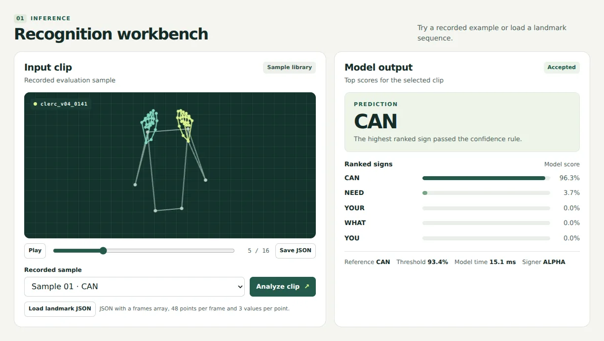
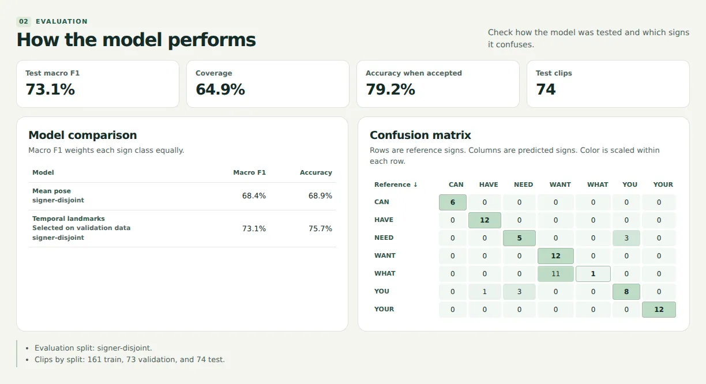
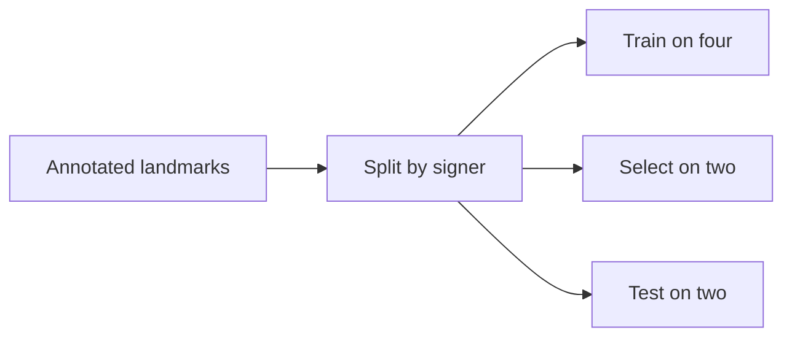

# SignLab ASL

A local workbench for recognizing **seven pre-segmented American Sign Language
glosses** from hand and upper-body landmarks. Replay held-out examples, inspect
ranked predictions, and see exactly where the model gets confused.

**0.731 macro F1** for temporal landmarks versus **0.684** for a mean-pose
baseline, measured on **74 clips from two signers held out of training and
validation**.

[Watch the short walkthrough](docs/media/walkthrough.mp4) ·
[See the benchmark](#benchmark) ·
[Run locally](#run-locally)

[](docs/media/walkthrough.mp4)

## What the demo shows

1. **Replay a real test clip.** The browser animates the hand and upper-body
   landmarks, with frame scrubbing and a reference gloss.
2. **Compare the top guess with the annotation.** The app displays ranked scores
   and abstains below a threshold selected on validation data.
3. **Inspect a confident error.** On clip `clerc_v04_0077`, the reference is
   **WHAT** and the model returns **WANT**. The evaluation view shows how often
   that confusion recurs.

The app runs inference on the local machine. It accepts landmark JSON and can
export a replayed sequence in the same format. An optional offline video tool
converts an MP4 of one trimmed sign into importable landmarks. Recognition
accuracy on newly recorded video remains unmeasured. [Video setup](video_tools/README.md)

## Benchmark

The data pipeline extracts 309 annotated segments from eight signers for
CAN, HAVE, NEED, WANT, WHAT, YOU, and YOUR. One low-signal segment was excluded.
The same four training signers, two validation signers, and two test signers
are used for both models. The validation split chooses the model and its
confidence cutoff.

| Model | Test macro F1 | Test top-1 accuracy | Pooled macro F1, eight signer folds |
| --- | ---: | ---: | ---: |
| Mean-pose logistic regression | 0.684 | 68.9% | 0.746 |
| Temporal landmark logistic regression | **0.731** | **75.7%** | **0.786** |



The first two columns use raw top predictions before abstention. The separate
eight-fold audit retrains fixed classifiers with one signer held out per fold
and pools their predictions. Temporal model macro F1 ranges from 0.633 to 0.932
across those signers.

**Where it fails.** The top guess is WANT on **11 of 12** WHAT clips. **Nine**
of those errors pass the cutoff. Across the full test set, the cutoff accepts
48 of 74 clips, with 38 correct among those 48. On validation, accepted accuracy
was 89.6% against the predeclared 90% target. These are softmax scores, and a high
score can still accompany an incorrect prediction.

The evaluation starts with known sign boundaries, and some prompts recur across
signers. Results cover this seven-gloss subset. Continuous signing, unfamiliar
phrases, and out-of-vocabulary inputs require separate evaluation.

[Full test report](artifacts/report.json) · [Eight-fold signer audit](artifacts/signer_audit.json)

## How it works



Each sequence is normalized for translation and scale. The baseline averages
poses over time. The temporal model also sees the ordered frames. Both include
body-relative position, local hand shape, and missing-point indicators. The
exported classifier uses NumPy arrays, and the local server uses Python's
standard library.

## Run locally

### Packaged demo

If you have the demo ZIP, unzip it and run these commands in its folder.
Use Python 3.10 or later.

```sh
python -m pip install -r requirements.txt
python app.py
```

### Source checkout

The source checkout includes the reports and the scripts to recreate the
trained model and demo clips. Use Python 3.11 or later and run these commands
from the repository root. The first data preparation run downloads the selected
CLERC files from a pinned revision. Later runs reuse the cache.

```sh
python -m pip install -r requirements-train.txt
python scripts/prepare_epee.py --out data/epee_glosses.npz
python -m model.train --data data/epee_glosses.npz --output artifacts --audit-signer-cv
python scripts/prepare_demo.py --data data/epee_glosses.npz
python app.py
```

Open **http://127.0.0.1:8765**. On Windows, use `py -3` if that is how you
invoke Python.

The demo includes 28 held-out examples. To import another sequence, use a JSON
array or an object with a `frames` field. Each frame has 48 points with three
coordinates per point. Use `null` for missing coordinates and up to 240 frames.

### Run the checks

```sh
python -m unittest model.test_model -v
python -m unittest discover -s tests -v
```

The model checks cover signer separation, feature normalization, and loading
the exported weights. The API checks use the prepared demo artifacts.

| Path | Contents |
| --- | --- |
| `scripts/` | Data acquisition and demo sample selection |
| `model/` | Features, signer splits, training, audit, and NumPy inference |
| `artifacts/` | Benchmark reports and output location for generated artifacts |
| `web/` | Local playback, predictions, and evaluation interface |
| `video_tools/` | Optional offline video-to-landmarks converter |

## Data and media credit

The screenshots and walkthrough render adapted hand and upper-body landmarks
from Florian Méloux and CLERC, *CLERC Épée v0.4: Sign Language Data Layer*
(2026), under **CC BY-NC-SA 4.0**. These visualizations show resampled
landmarks without source video. Pseudonymous landmarks can still contain
identifying body geometry. The provenance file describes the dataset terms
and the limits on use.

[Dataset card](https://huggingface.co/datasets/CLERC-DATA/epee) ·
[Data provenance](DATA_PROVENANCE.md) ·
[CC BY-NC-SA 4.0](https://creativecommons.org/licenses/by-nc-sa/4.0/)
